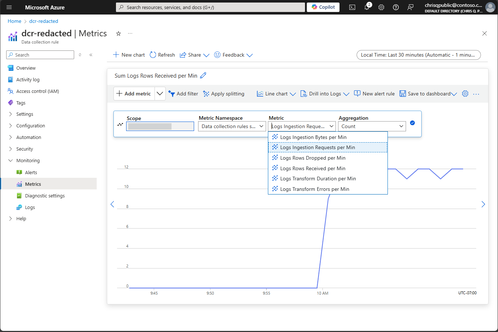
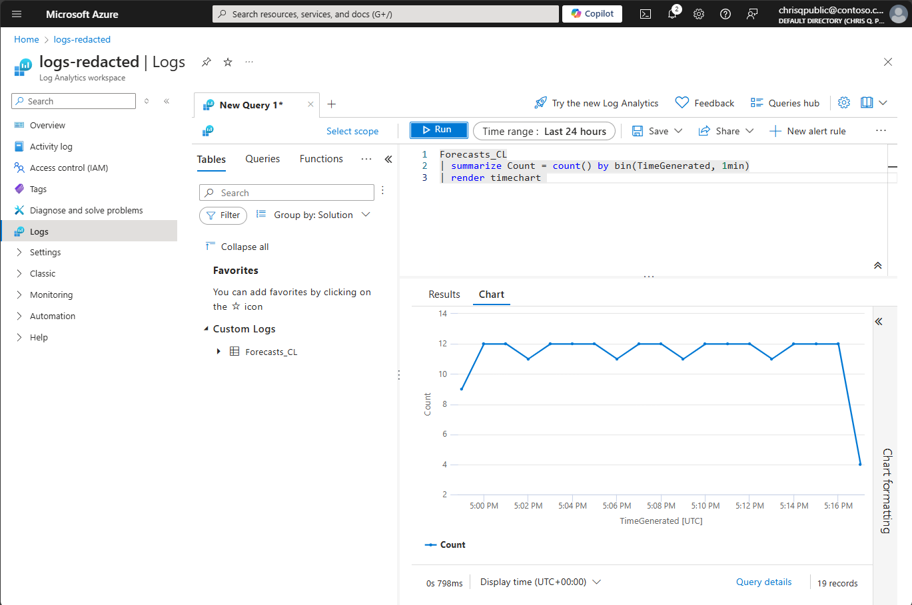

# AzLogs.Ingestion Sample

[](https://github.com/jcoliz/AzLogs.Ingestion/actions/workflows/build.yml)

This is a complete end-to-end sample using the [Logs Ingestion API in Azure Monitor](https://learn.microsoft.com/en-us/azure/azure-monitor/logs/logs-ingestion-api-overview) on .NET 8.0.
The sample runs as an [Azure Function](https://learn.microsoft.com/en-us/azure/azure-functions/functions-overview?pivots=programming-language-csharp), retrieving weather forecasts from the U.S. [National Weather Service API](https://www.weather.gov/documentation/services-web-api), then forwarding them on to a [Logs Analytics Workspace](https://learn.microsoft.com/en-us/azure/azure-monitor/logs/log-analytics-workspace-overview) using a [Data Collection Rule](https://learn.microsoft.com/en-us/azure/azure-monitor/essentials/data-collection-rule-overview). Alternatively, you might find the simpler [Quickstart Sample](https://github.com/jcoliz/AzLogs.Ingestion.Quickstart) a better starting point.

## Use case

Let's say we have some important data available in an external service, and we want some of that data in our Log Analytics Workspace. However, we don't control the external service, so we can't simply modify it to upload logs directly. What we can do instead is:

* **Extract** the data using an Azure Function, then send to a Data Collection Endpoint, which will
* **Transform** it into our desired schema using the Data Collection Rule, and
* **Load** it into a Log Analytics Workspace table.

## Architecture

<p align="center"></p>

Our Azure Function application sits at the center of the system, doing all the work.
It periodically pulls data from an external source (here, weather.gov) then forwards it to a Log Analytics Workspace
using a Data Collection Endpoint and Data Collection Rule.

## Prerequisites

In order to follow the instructions shown here, and run this sample, you will first need:

* An Azure Account. Set up a [Free Azure Account](https://azure.microsoft.com/en-us/pricing/purchase-options/azure-account) to get started.
* [Azure CLI tool with Bicep](https://learn.microsoft.com/en-us/azure/azure-resource-manager/bicep/install#azure-cli)
* [Azure Functions Core Tools](https://learn.microsoft.com/en-us/azure/azure-functions/functions-run-local?tabs=windows%2Cisolated-process%2Cnode-v4%2Cpython-v2%2Chttp-trigger%2Ccontainer-apps&pivots=programming-language-csharp#install-the-azure-functions-core-tools) 

Please complete the [Quickstart Sample](https://github.com/jcoliz/AzLogs.Ingestion.Quickstart) first before proceeding with this more in-depth sample. 
This sample builds on the foundational concepts illustrated in that sample.

## Register a Microsoft Entra app

The very first step is to [Register an application with the Microsoft Identity Platform](https://learn.microsoft.com/en-us/entra/identity-platform/quickstart-register-app?tabs=client-secret). 

From a PowerShell window in this folder, run the `Create-AppRegistration.ps1` script:

```dotnetcli
.\scripts\Create-AppRegistration -Name "azlogs-ingestion"
```

After completion, this script will display configuration values you'll need later to configure the app, _e.g._

```json
"AZURE_TENANT_ID": "<tenant_id>",
"AZURE_CLIENT_ID": "<client_id>",
"AZURE_CLIENT_SECRET": "<client_secret>"
```

Additionally, it will display the Service Principal ID needed when deploying Azure resources, next, _e.g._

```powershell
-ServicePrincipal <principal_id>
```

## Deploy Azure resources

This sample requires five Azure resources: Log Analytics Workspace, Data Collection Rule, Data Collection Endpoint, Azure Function, and Storage Account. There is an Azure Resource Manager (ARM) template here to set up everything you need, ready to go: [azlogs-ingestion-fn.bicep](./.azure/deploy/azlogs-ingestion-fn.bicep).
Be sure to clone this repo with submodules so you have the [AzDeploy.Bicep](https://github.com/jcoliz/AzDeploy.Bicep) project handy with the necessary module templates.

```powershell
 git clone --recurse-submodules https://github.com/jcoliz/AzLogs.Ingestion.git
```

From a PowerShell window in this folder, run the `Deploy-Services.ps1` script. Be sure to supply the `principal_id` for your app, from the previous step. Also, feel free to choose any resource group name and Azure data center location:

```dotnetcli
./scripts/Deploy-Services -ResourceGroup "azlogs-ingestion-quickstart" -Location "West US 2" -ServicePrincipal "<principal_id>"
```

After completion, this script will display configuration values you'll need in the next step, _e.g._

```text
Your function app is named: <function_app_name>

Copy these values to local.settings.json:

"LogIngestion__DcrImmutableId": "<data_collection_rule_id>",
"LogIngestion__EndpointUri": "<data_collection_endpoint_uri>",
"LogIngestion__Stream": "Custom-Forecasts_CL",
"AzureWebJobsStorage":  "<storage_connection_string>",
```

## Configurate local secrets

No additional configuration is needed for the Azure Function when running in production. However, to run it locally we'll need to set up a `local.settings.json` file to store local configuration, including secrets. This
file is not committed to source control. Within the [FunctionApp](./FunctionApp/) folder, copy [local.settings.template.json](./FunctionApp/local.settings.template.json) to a new file named `local.settings.json`. 
Fill out the details using the information displayed in the previous steps.

## Run locally

We'll first build the app, then run it using the pre-requisite [Azure Functions Core Tools](https://learn.microsoft.com/en-us/azure/azure-functions/functions-run-local?tabs=windows%2Cisolated-process%2Cnode-v4%2Cpython-v2%2Chttp-trigger%2Ccontainer-apps&pivots=programming-language-csharp#install-the-azure-functions-core-tools) 

```dotnetcli
func host start
```

We can watch the function running locally.

```text
Azure Functions Core Tools
Core Tools Version:       4.0.6280 Commit hash: N/A +421f0144b42047aa289ce691dc6db4fc8b6143e6 (64-bit)
Function Runtime Version: 4.834.3.22875

[2024-10-07T21:08:37.740Z] Found AzLogs.Ingestion\FunctionApp\FunctionApp.csproj. Using for user secrets file configuration.
[2024-10-07T21:08:41.503Z] Worker process started and initialized.
[2024-10-07T21:08:50.040Z] Executing 'Functions.TransferLogs' (Reason='Timer fired at 2024-10-07T14:08:50.0203981-07:00', Id=9113238c-28cc-4e95-8e40-ca6ed1c49f18)
[2024-10-07T21:08:50.260Z] FetchForecastAsync: Received OK {"number":1,"name":"This Afternoon","startTime":"2024-10-07T13:00:00-07:00","endTime":"2024-10-07T18:00:00-07:00","isDaytime":true,"temperature":74,"temperatureUnit":"F","temperatureTrend":"","probabilityOfPrecipitation":{"value":null,"maxValue":0,"minValue":0,"unitCode":"wmoUnit:percent","qualityControl":"Z"},"dewpoint":null,"relativeHumidity":null,"windSpeed":"6 mph","windGust":null,"windDirection":"S","icon":"https://api.weather.gov/icons/land/day/few?size=medium","shortForecast":"Sunny","detailedForecast":"Sunny, with a high near 74. South wind around 6 mph."}
[2024-10-07T21:08:50.285Z] ClientSecretCredential.GetToken invoked. Scopes: [ https://monitor.azure.com//.default ] ParentRequestId: cffc2485-1fda-4770-8887-5e48b917c0c0
[2024-10-07T21:08:51.010Z] Request [cffc2485-1fda-4770-8887-5e48b917c0c0] POST https://dcep-redacted.westus2-1.ingest.monitor.azure.com/dataCollectionRules/dcr-redacted/streams/Custom-Forecasts_CL?api-version=2023-01-01
[2024-10-07T21:08:51.439Z] UploadToLogsAsync: Sent OK 204
[2024-10-07T21:08:51.439Z] Run: OK
[2024-10-07T21:08:51.460Z] Executed 'Functions.TransferLogs' (Succeeded, Id=9113238c-28cc-4e95-8e40-ca6ed1c49f18, Duration=1432ms)
```

## Publish and run remotely

Now that you can see it all running locally, it's time to publish to Azure! You'll need the name of the function app which you deployed earlier. This was displayed when the deployment script finished.

```dotnetcli
func azure functionapp publish <function_app_name>
```

Once it's complete, you can connect with the remote logstream:

```dotnetcli
func azure functionapp logstream <function_app_name>
```

This gives us easy access to watch the remote logs from the comfort of our terminal window:

```text
2024-10-09T00:57:20Z   [Information]   Executing 'Functions.TransferLogs' (Reason='Timer fired at 2024-10-09T00:57:20.0008780+00:00', Id=7e58f0b2-91b6-4a43-b3c9-a61642e42f38)
2024-10-09T00:57:20Z   [Information]   FetchForecastAsync: Received OK {"number":1,"name":"This Afternoon","startTime":"2024-10-08T17:00:00-07:00","endTime":"2024-10-08T18:00:00-07:00","isDaytime":true,"temperature":67,"temperatureUnit":"F","temperatureTrend":"","probabilityOfPrecipitation":{"value":40,"maxValue":0,"minValue":0,"unitCode":"wmoUnit:percent","qualityControl":"Z"},"dewpoint":null,"relativeHumidity":null,"windSpeed":"6 mph","windGust":null,"windDirection":"S","icon":"https://api.weather.gov/icons/land/day/rain_showers,40?size=medium","shortForecast":"Chance Rain Showers","detailedForecast":"A chance of rain showers. Partly sunny, with a high near 67. South wind around 6 mph. Chance of precipitation is 40%. New rainfall amounts less than a tenth of an inch possible."}
2024-10-09T00:57:20Z   [Information]   Request [a2176ba6-b497-478e-8cf4-4dc4b0974eda] POST https://dcep-redacted.westus2-1.ingest.monitor.azure.com/dataCollectionRules/dcr-redacted/streams/Custom-Forecasts_CL?api-version=2023-01-01
2024-10-09T00:57:20Z   [Information]   UploadToLogsAsync: Sent OK 204
2024-10-09T00:57:20Z   [Information]   Run: OK
2024-10-09T00:57:20Z   [Information]   Executed 'Functions.TransferLogs' (Succeeded, Id=7e58f0b2-91b6-4a43-b3c9-a61642e42f38, Duration=74ms)
```

## Publish your application in production

There are two different approaches to publishing your application in production via a pipeline:

In this sample, the [build.yaml](./.github/workflows/build.yml) GitHub workflow creates a publish-ready ZIP archive, then attaches it to the build results to be retrieved manually. This follows the [Publish your application](https://learn.microsoft.com/en-us/azure/azure-functions/dotnet-isolated-process-guide?tabs=windows#publish-your-application) guidance for .NET isolated process functions. You would then transfer this file into your deployment process. If you were creating a [Sentinel Data Connector](https://github.com/Azure/Azure-Sentinel/blob/master/DataConnectors/ReadMe.md), for example, you would include this built package in your pull request.

Alternately, you could follow the guidance describing [Continuous delivery by using GitHub Actions](https://learn.microsoft.com/en-us/azure/azure-functions/functions-how-to-github-actions?tabs=windows%2Cdotnet&pivots=method-cli). In this case, you would set up a CD pipeline, which would deploy the latest bits to your running function resource.

## Verify data flow

After observing that logs are sent successfully to Log Analytics from the client application logs, it's time to turn our attention
to verifying the data has landed correctly in the service. Using the Azure Portal, navigate to the resource group you created above, e.g. `azlogs-ingestion`, then click into the Data Change Rule resource. In the navigation panel on the left, expand "Monitoring", then choose "Metrics". Click "Add Metric", then choose "Logs Ingestion Requests per Min". You should see a chart like the one below:



Next, we can look at the Log Analytics workspace itself to confirm that the logs have landed in their final destination. Again, navigate to the resource group page, but this time click into the Log Analytics resource. Click "Logs", and then enter this query:

```kql
Forecasts_CL
| summarize Count = count() by bin(TimeGenerated, 1min)
| render timechart 
```

If all is well, you will see a chart like the one below:



Congratulations, you have successfully ingested logs into a Log Analytics Workspace custom table using a Data Collection Rule!

## Tear down

When you're done, don't forget to tear down the resource group to avoid unexpected charges.

```powershell
az group delete --yes --name $env:RESOURCEGROUP
```
